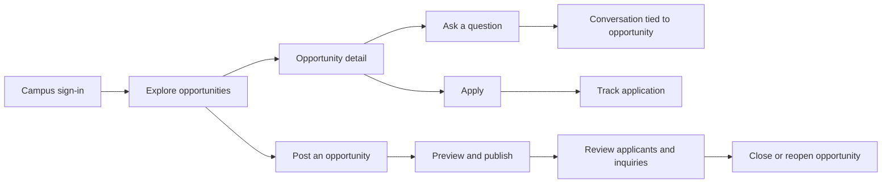

# Akatsuki — Frontend UI/UX Direction

Status: proposed high-level design plan, before frontend implementation.

Audience: young college students finding opportunities, forming project teams, and recruiting peers.

Product basis: `idea.md`, the project READMEs, and the current Rust models, handlers, and routes. The repository currently contains a backend and product documentation; the frontend will be designed from scratch. All visual choices below are starting directions to refine through prototypes.

**1. The product experience**

Akatsuki should feel like an independent campus collective: expressive, confident, slightly underground, and welcoming to students who want to build something together.

The central promise is: **Find your people. Build something that matters.**

The Akatsuki identity comes from the black cloak, crimson clouds, strong silhouettes, and sense of belonging. Translate those qualities into composition, color, and atmosphere. Students should understand the product even if they have never watched Naruto.

The core experience must answer three questions quickly:

- What can I join that fits my interests and availability?
- Who is behind it, and what would I actually do?
- How do I ask a question, apply, or follow up?

For a student posting an opportunity, the equivalent promise is: **Find collaborators and keep every conversation attached to the right opportunity.** This context is the product's strongest differentiator and deserves visible design attention.

**2. Design principles for young students**

- **Strong first impression, calm daily use.** Concentrate atmosphere on the entry page, brand moments, and empty states. Keep reading, applying, and messaging comfortable over longer sessions.
- **Make the next step obvious.** Every screen has a clear primary purpose and action. Preserve a separate path for students who want to ask a question before applying.
- **Show practical details early.** Compensation, location, required skills, and deadline matter more than decorative labels.
- **Support students with little experience.** Use friendly pitch prompts and optional resume links. Avoid making a polished professional profile a prerequisite for participation.
- **One student, multiple intentions.** The same person can apply to a research role and recruit for a hackathon. Use one account and shared navigation, without a mandatory applicant/recruiter mode switch.
- **Earn trust through clarity.** Show identity provenance, meaningful status, and what will be shared before submission. A verified identity does not mean an opportunity is endorsed by the college.
- **Respect attention.** Use purposeful badges and short transitions. Theme intensity must not compete with urgent messages or important decisions.

**3. Art direction: the crimson cloud collective**

The recommended base is a dark editorial interface with warm charcoal backgrounds, layered surfaces, off-white typography, and deliberate crimson accents. Give the design energy through scale, alignment, and sharp graphic crops.

| Element | Proposed direction | Purpose |
| --- | --- | --- |
| Canvas | Warm near-black, starting around `#101012` | Establish the cloak-inspired atmosphere |
| Surfaces | Charcoal layers around `#19191D` and `#232329` | Separate content without excessive shadows |
| Primary text | Soft ivory around `#F4F1EC` | Comfortable reading and strong hierarchy |
| Secondary text | Neutral gray around `#B0ADB5` | Legible supporting details |
| Brand accent | Crimson around `#C92D45`, with brighter variants where needed | Primary actions, active navigation, signature details |
| Status colors | Distinct amber, green, blue, and neutral treatments | Keep functional meaning independent of the red brand |
| Typography | Expressive display sans paired with a highly legible UI sans | Youthful identity with reliable readability |
| Shape | Mostly clean rectangles with modest rounding; pills for compact metadata | A consistent balance of edge and approachability |
| Texture | Sparse grain, ink-like edges, and occasional cloud outlines | Add atmosphere without reducing text clarity |

These colors are exploratory tokens. Validate actual foreground/background pairs before adopting them, including crimson buttons and small text.

Explore a display face such as Space Grotesk with a body face such as Inter or an equally readable alternative. Use oversized headings selectively, normal sentence case for UI text, and compact uppercase only for short eyebrow labels. Keep body text around 16px on mobile.

Use an original cloud-inspired brand mark and a consistent line-icon family. Reserve the cloud for the logo, entry artwork, empty states, and occasional framing. The interface should still feel recognizable when the large illustration is removed.

Character artwork, if introduced later, belongs in occasional expressive surfaces with suitable assets. The core system should work through its own typography, colors, and composition. Anime terminology can appear in optional flavor copy; functional navigation stays understandable: Explore, Applications, Messages, My posts.

**4. Theme intensity by context**

| Context | Intensity | Visual treatment |
| --- | --- | --- |
| Entry page | High | Large wordmark, cropped cloud composition, strong headline, one memorable transition |
| Explore | Medium | Compact brand banner, crimson active states, disciplined opportunity rows |
| Opportunity detail | Medium-low | Strong title and clear content sections with a restrained brand accent |
| Apply and post forms | Low | Clean fields, readable guidance, unmistakable actions |
| Messages and applicant review | Low | Quiet surfaces, stable structure, high information clarity |
| Empty states and successful actions | Medium | Small cloud illustration and brief, encouraging copy |

Avoid repeated background animation, automatic audio, and long entrances. Motion must never delay access to the product.

**5. Information architecture**

Use a small, stable set of destinations:

| Destination | Student need | Main content |
| --- | --- | --- |
| Explore | Find something worth joining | Search, filters, opportunity feed |
| Applications | Know where things stand | Submitted applications and current status |
| Messages | Continue a conversation in context | Threads with the opportunity always visible |
| My posts | Recruit and manage responses | Owned opportunities, applicants, inquiries, open/closed controls |
| Profile and preferences | Understand identity and adjust the experience | Verified details, available profile information, interface preferences |

“Post an opportunity” is a prominent action available from Explore and My posts. Profile lives behind the avatar on desktop and an accessible header control on mobile.

Desktop uses a compact left navigation rail, a content header, and a flexible main area. Mobile uses a four-item bottom navigation for Explore, Applications, Messages, and My posts. Avoid a fifth destination for every future feature.

Returning students enter Explore. Students arriving through an opportunity link return to that opportunity after authentication. Preserve search, filters, and scroll position when moving between the feed and a detail page.

**6. The main journeys**

The applicant journey should feel lightweight: find a relevant role, understand the commitment, send a short pitch, and see confirmation. The creator journey should reduce repeated explanation: publish clear details, answer questions in context, review candidates, and close the listing when recruitment ends.

**7. Entry and campus sign-in**

Create a compact, memorable public entry page with a large headline, the cloud composition, a concise explanation of the campus opportunity hub, and a clear “Continue with college ERP” action. Include a small product preview to show what happens after signing in. Avoid invented activity counts, testimonials, or university endorsements.

The sign-in view should explain why campus identity is requested and distinguish the app from the official ERP service. Keep fields conventional, support password visibility and password managers, and provide useful states for invalid credentials, an unavailable ERP service, and an expired session.

After login, briefly show the identity returned by the ERP and let the student continue. Optional preferences should be skippable and should only be introduced when they have a real effect on discovery. Do not block browsing behind a lengthy onboarding questionnaire.

**8. Explore: the primary daily screen**

The first viewport should contain the page purpose, search, useful filters, and real opportunities. Keep any welcome banner compact enough that the feed remains visible on a phone.

Suggested order:

1. Short heading, such as “Find your next opportunity,” with the posting action nearby.
2. Search by role, skill, or keyword.
3. Category controls: internships, part-time roles, research, project teams, campus gigs, and tutoring.
4. Filters for location mode and department, plus a visible way to clear them.
5. Result count, active filter chips, and the opportunity list.

Prefer a single-column feed of well-composed cards or rows for easy comparison. On wide screens, use the additional space for persistent filters rather than multiplying narrow cards. Prototype both densities before locking the layout.

Each opportunity should surface the title, category, compensation, location mode, a few skill tags, poster identity, and posted date or deadline. Use sensible fallbacks: missing compensation becomes “Compensation not specified,” not “Unpaid.” Avoid exposing roll numbers in the feed.

Prototype with believable student content: “Frontend collaborator for a campus notes app,” “Robotics lab research assistant,” and “Designer for a hackathon team.” Include long titles, missing fields, and several departments.

Start with newest open opportunities. The current backend has search and basic filters; personalized ranking, compensation filtering, and alternative sort orders need additional product and API work. Use explicit “Load more” behavior initially, with stable navigation back to the same results.

**9. Opportunity detail: help the student decide**

Create a clear reading hierarchy: title and status, essential facts, role description, required skills, poster information, and actions.

On desktop, use a readable main column with a compact action panel. On mobile, put essentials near the top and use a sticky action area that respects the keyboard and device safe areas. “Apply” is primary; “Ask a question” is secondary.

Encourage creators to explain the work, expected time commitment, compensation, and who would fit. Where these are not structured data fields, use guidance in the description editor without pretending the information is independently filterable.

Design variants explicitly:

- Open: apply or start an inquiry.
- Already applied: show application status and a link to the submitted application.
- Closed: explain that new applications and new inquiries are unavailable; existing conversations remain accessible.
- Own opportunity: show management actions instead of Apply.
- Missing or removed: explain what happened and offer a route back to Explore.

“Closed” does not necessarily mean “Filled,” and a closed listing does not automatically mean an application was rejected. Keep those states separate.

**10. Applying and tracking progress**

Use a short application form with the opportunity title, the identity details being shared, a pitch field, and an optional resume link. Offer guidance such as “What interests you, and what could you contribute?” Resume upload requires separate support; the existing contract accepts a link.

Use a focused dialog on desktop if space permits and a full-page flow on mobile. Preserve input across validation errors and transient failures. Show the submitted state only after the server confirms receipt, and prevent accidental duplicate submission.

Confirmation should state “Application sent” and link to Applications. The tracking view shows the role, submitted date, current status, and a way back to the details or relevant conversation.

Map backend statuses to clear language:

| Stored status | Student-facing label |
| --- | --- |
| PENDING | Submitted |
| SHORTLISTED | Shortlisted |
| ACCEPTED | Accepted |
| REJECTED | Not selected |

Display the current status with a short explanation. Avoid implying that every application passes through each stage, that a creator has read it, or that a full event history exists. Status history would need additional data.

**11. Messages: make context the signature feature**

Every thread should visibly identify both the person and the opportunity. Two conversations with the same person about different roles must remain distinguishable.

On desktop, use a thread list and conversation pane. Let creators group inquiries by their posted opportunity without forcing every user through a third column. On mobile, use separate list and thread screens with predictable back navigation.

The thread header includes a link to the opportunity and its open/closed state. Show clear unread counts, readable timestamps, grouped messages, and typing feedback when supported. A closed opportunity should retain an informative banner while existing participants continue coordination.

Design sending, sent, failed, reconnecting, and offline states. Preserve an unsent message when navigation or connection problems occur. Avoid online-presence badges or delivery/read promises until their behavior is verified end to end. Reconnect behavior must recover missed messages, not simply restore the connection indicator.

The initial scope is private text conversations tied to opportunities. Attachments, group chat, and generic social DMs belong to later product decisions.

**12. Posting and managing opportunities**

Use a short guided flow with three stages: basics, details, preview. Keep stage labels plain and let the creator move backward without losing work.

Collect title, category, location mode and optional location, description, skills, compensation, department relevance, and optional deadline. Explain ambiguous fields; a department filter should not silently become a strict eligibility rule. Optional fields should look optional.

Preview the actual opportunity layout before publication. After publishing, provide the opportunity link and direct access to its management screen. Draft recovery is valuable but requires an explicit persistence decision; only claim “Saved” when persistence succeeds, and clarify if recovery is limited to the current device.

My posts should emphasize work requiring attention: unread inquiries and applications awaiting a decision. Within a posting, use Overview, Applicants, and Inquiries sections. Start applicant review with a clear list and detail pane on desktop, and a list-to-detail flow on mobile.

Keep shortlist, accept, and reject actions visibly distinct. Confirm consequential decisions where needed and report failures clearly. Closing a listing must explain that it stops new applications and inquiries while preserving existing conversations. Prefer explicit Close/Reopen actions over an ambiguous unlabeled switch.

Keep deletion secondary and explain its consequences. Reopening should not imply that past application decisions were reset.

**13. Profile, identity, and trust**

The first profile screen is a concise view of the student's campus identity and available profile details. Keep official ERP fields distinct from editable self-description when editing becomes supported.

Show name and department where useful; reveal additional identifiers only where needed for the application or management task. Explain the information shared with a creator before submission.

Use an “ERP verified” badge only when the backend provides reliable verification provenance. The current application also has local registration, so a frontend cannot safely infer that every account went through ERP authentication. Do not render automatically imported contact details as public profile copy without a deliberate product decision.

Provide clear logout and expired-session flows. Reporting misleading opportunities and blocking abusive contact are valuable launch considerations, but require a backend and operational workflow before their controls can be presented as functional.

**14. Shared interaction and accessibility standards**

Build a small shared design system: navigation, buttons, inputs, filter chips, opportunity cards, identity summaries, status badges, tabs, dialogs, notices, toasts, empty states, and chat elements. Define hover, focus, pressed, disabled, loading, error, and success states together.

Target WCAG 2.2 AA: sufficient contrast, visible keyboard focus, meaningful labels, logical focus order, and status information that never relies on color alone. Aim for touch targets of at least 44 × 44 CSS pixels and support zoom, long content, screen readers, and reduced motion.

Use short transitions around 120–200ms for controls and slightly longer transitions for panels when helpful. Respect reduced-motion settings. Avoid layout movement that makes a list item or button shift under the student's pointer.

Design distinct recovery states: an empty campus feed, no filter matches, no applications yet, no inquiries yet, a failed request, expired authentication, and temporary disconnection. An empty result and a server failure need different explanations and actions.

**15. Responsive behavior and performance**

Treat mobile as a complete product. Design at narrow phone widths first, then validate tablet and desktop compositions. Give forms, message composition, filter sheets, and sticky actions special attention when the on-screen keyboard is open.

Use full-screen sheets or pages where desktop dialogs become cramped. Preserve navigation context and avoid hover-only actions. Hide decorative artwork before removing useful information.

Keep brand graphics lightweight, load optional imagery on demand, and limit font variants. Avoid heavy video or WebGL as a dependency of the main experience. Proposed performance targets are LCP within 2.5 seconds, INP within 200ms, and CLS below 0.1 at the 75th percentile, to validate once the frontend exists.

**16. Scope and backend dependencies**

| Capability | Current basis | Planning decision |
| --- | --- | --- |
| ERP sign-in and profile retrieval | Routes exist | Core first-release flow; verify identity provenance |
| Discovery, search, category/location/department filters | Routes and fields exist | Core first-release flow |
| Job detail, creation, editing, open/closed management | Routes exist | Core first-release flow |
| Applications and current status | Routes exist | Core first-release flow; avoid invented history |
| Opportunity-specific text conversations | REST and WebSocket support exists | Core first-release flow; verify reconnect and unread behavior |
| Profile editing | Fields exist, no update route found | Add an API before exposing editable profile controls |
| Saved opportunities | No persistence route found | Later feature or explicitly scoped local-only experiment |
| Draft syncing, resume uploads, attachments | No supporting routes found | Separate enhancements |
| Notification center, push, email alerts | No complete workflow found | Use existing in-app message indicators first |
| Personalized recommendations and skill matching | No ranking capability found | Later, after useful data and relevance validation |
| Report/block and moderation | No supporting workflow found | Resolve scope before opening a broad campus pilot |

Endpoint existence is a planning input, not a claim that integration or security testing has passed. Do not add decorative controls for capabilities that cannot work.

**17. Heavy refinement: the proposed design sequence**

| Pass | Main work | Reviewable output | Exit criterion |
| --- | --- | --- | --- |
| 1. Experience structure | Prioritize tasks, map navigation, identify state and data gaps | Journey map, screen inventory, scope decisions | Applicant and creator journeys are complete without dead ends |
| 2. Visual exploration | Explore three Akatsuki treatments: graphic clouds, restrained editorial, and ink/texture | The same Explore screen in three treatments, plus mobile crops | Select a direction that balances identity, readability, and student appeal |
| 3. Layout prototype | Shape Explore, detail, application, and messages with realistic content | Connected low-fidelity desktop/mobile prototype | Students can find, understand, ask, and apply without instruction |
| 4. Signature screen refinement | Refine type, spacing, card anatomy, crimson usage, and cloud placement | High-fidelity Explore, detail, and message screens | The identity feels consistent across both expressive and quiet screens |
| 5. System expansion | Apply the chosen system to posting, management, tracking, and identity | Complete screen set and component/state library | Components behave consistently and essential edge states are covered |
| 6. Usability and accessibility | Test on phones, keyboard, slow connections, and realistic student tasks | Findings ranked by task impact | Critical task blockers and major readability issues are resolved |
| 7. Frontend implementation and browser polish | Build complete journeys, connect APIs, then refine real interactions | Working responsive frontend | Visual quality and state behavior hold with real data |

The recommended starting point for visual exploration is the restrained editorial direction, with a bolder cloud composition for entry. Compare variants using the same content and viewport so choices reflect the design rather than different example data.

During refinement, prioritize task flow, content hierarchy, spacing, typography, contrast, component consistency, and finally decorative motion. Keep a short decision log of what changed, the observed problem, and why the new version is better.

**18. Validation and success criteria**

Recruit approximately five to eight students across departments, including Naruto fans, non-fans, students with little work experience, and students recruiting collaborators. Small studies reveal usability problems; they do not establish statistically reliable conversion rates.

Ask participants to find a relevant opportunity, identify compensation and expectations, ask a question, submit an application, find its status, publish a role, and locate inquiries for that role. Check that they distinguish application status from listing status and understand what happens when a listing closes.

Initial design targets to validate:

- A new visitor can explain the app's purpose within a few seconds of seeing the entry screen.
- Most participants can locate a relevant opportunity and understand its key facts without assistance.
- Students can submit a prepared short application in roughly a minute, excluding time spent writing their pitch.
- Creators can identify which opportunity a message concerns without reading the conversation history.
- Essential tasks work on narrow mobile screens, with keyboard navigation, and with reduced motion.

After launch, measure discovery-to-detail, detail-to-application, application completion, posting completion, and creator response time. Establish baselines before setting numerical conversion goals. Use minimal event data; message bodies, resumes, and ERP credentials do not belong in product analytics.

**19. The intended first-release impression**

A student opens Akatsuki and recognizes the crimson cloud identity immediately. Within the first screen, they see useful campus opportunities. A role is easy to understand, a question starts the correct conversation, and an application has an unambiguous outcome. When that same student needs a collaborator, posting and reviewing responses feels like a natural extension of the experience.

The next concrete design artifact is a comparison of three Explore-screen directions with a matching mobile view. That establishes the visual language before expanding it across the full frontend.
