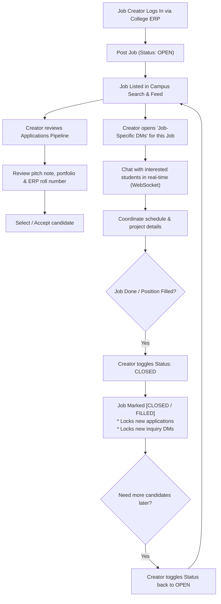
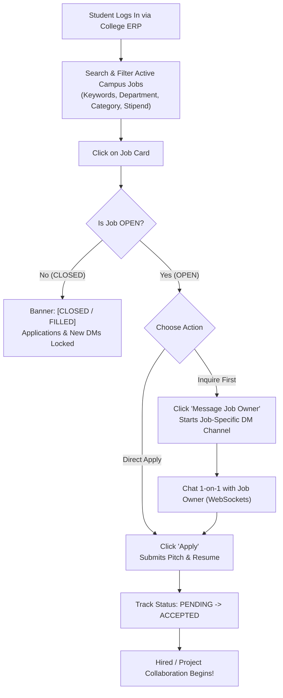
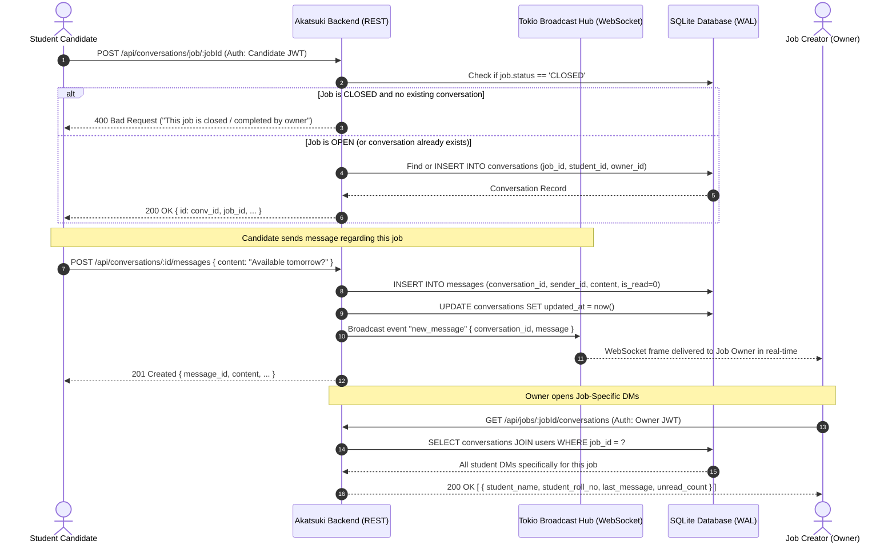
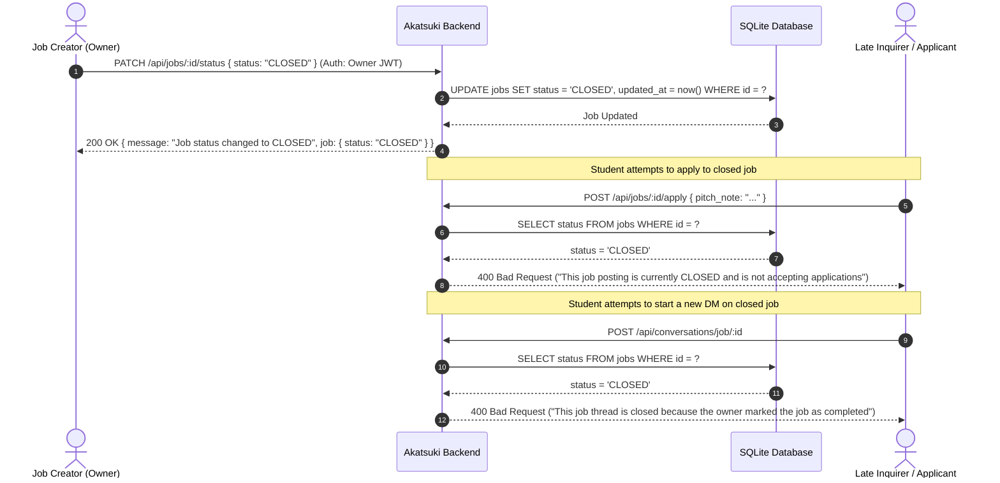
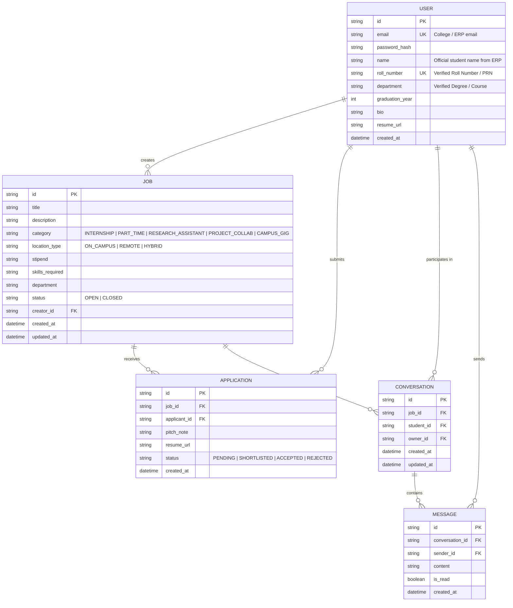

# 🎓 Akatsuki - Campus Job & Opportunity Hub (Job-Centric DMs Architecture)

## 📌 Executive Summary
**Akatsuki** is an exclusive intra-college job & opportunity platform designed specifically for students, campus research labs, student-led startups, student organizations, and campus recruiters. 

In generic job platforms or casual WhatsApp groups, when a student creator posts multiple opportunities (e.g. *Frontend Developer for Startup*, *Research Assistant for Robotics Lab*, *Graphic Designer for Hackathon*), inquiries get scattered into one chaotic inbox with zero context.

**Akatsuki solves this with Job-Specific Direct Messaging (Job-Centric DMs)**:
- Every job listing has its own dedicated DM channel list.
- When an interested student clicks **"Message Job Owner"**, a private 1-on-1 DM channel is created that is permanently bound to that specific `jobId`.
- In the creator's dashboard, under each job posting, the owner sees **"Inquiries / DMs for this Job"** with student profiles, unread message badges, and latest chat history.
- The creator can toggle the job between **`OPEN`** and **`CLOSED`** (when the job is done/filled). When closed, incoming applications and new inquiry DMs are automatically locked.

Access is strictly gated via **College Email / ERP Authentication (MIT ERP API)**, ensuring 100% verified campus identity (Roll Number, Full Name, Department).

---

## 💡 The Core Architecture: Job-Specific DMs & Open/Closed Lifecycle

```
┌────────────────────────────────────────────────────────────────────────┐
│                        Campus Job Posting                              │
│   "Full-Stack Rust/React Dev for Campus AI Startup"  [Status: OPEN]    │
│   Posted by: Alex Chen (CS2026-042, Computer Science)                  │
└───────────────────────────────────┬────────────────────────────────────┘
                                    │
          ┌─────────────────────────┴─────────────────────────┐
          │                                                   │
          ▼                                                   ▼
┌──────────────────────────────────────┐            ┌───────────────────┐
│     Job-Specific DMs for THIS Job    │            │    Formal Apply   │
│  ├── Student A (BT2027-118): "Hey..."│            │  Pitch & Resume   │
│  ├── Student B (MECH2027-042): "Is..."            │  Roll No attached │
│  └── Student C (CS2027-009): "Can..."             └─────────┬─────────┘
└──────────────────┬───────────────────┘                      │
                   │                                          │
                   └────────────────────┬─────────────────────┘
                                        │
                                        ▼
┌────────────────────────────────────────────────────────────────────────┐
│                   Owner Action: "Job Done / Close Job"                 │
│                      Job marked [CLOSED / FILLED]                      │
│     * Displays [CLOSED] badge on the job listing                       │
│     * Locks new job applications                                       │
│     * Locks new student inquiry DMs                                    │
│     * Existing conversations remain accessible for coordination        │
│     * Owner can re-open to [OPEN] if more candidates needed            │
└────────────────────────────────────────────────────────────────────────┘
```

---

## 👥 User Personas & Flows

### 1. Job Creator Flow (Job Owner)


#### Step-by-Step Creator Flow:
1. **ERP Login**: Logs in with college ERP credentials (`POST /api/auth/erp-login`) to obtain verified student credentials.
2. **Post Job**: Creates a job opportunity with title, description, skills, category, and stipend. Initial status is **`OPEN`**.
3. **View Job-Specific DMs**: Under that job card, the creator views all student inquiries exclusively belonging to this job (`GET /api/jobs/:id/conversations`). The creator sees the student's name, roll number, department, snippet of the last message, and unread badges.
4. **Review Applications**: Evaluates submitted applications (`GET /api/jobs/:id/applications`) and updates application status (`PENDING` -> `ACCEPTED` / `REJECTED`).
5. **Real-Time Coordination**: Chats back and forth with candidates in real-time via WebSockets (`/ws?token=...`).
6. **Close Job (Job Done)**: Once the candidate is hired or the task is finished, the owner sets status to **`CLOSED`** (`PATCH /api/jobs/:id/status`).
   - The job displays a `CLOSED` badge.
   - New applications are locked.
   - New inquiry DMs from other students are locked.
   - Existing chat history remains preserved.
7. **Reopen Job**: The creator can re-open the listing to `OPEN` anytime with 1 click if new openings arise.

---

### 2. Job Seeker / Candidate Flow


#### Step-by-Step Candidate Flow:
1. **ERP Login**: Authenticates via official college credentials.
2. **Search & Discovery**: Browses campus opportunities with search filters (category, branch, location, stipend).
3. **Message Job Owner**: Clicks "Message Job Owner" to ask questions directly about the job (`POST /api/conversations/job/:jobId`). This thread is permanently linked to the job.
4. **Apply to Job**: Submits a pitch note and resume link (`POST /api/jobs/:id/apply`). Verified college credentials (Roll No, Department, Year) are automatically attached.
5. **Live Chat**: Receives real-time replies from the job owner over WebSockets.
6. **Closed State**: If the job is closed, the candidate sees the `CLOSED` badge and cannot submit late applications or new DMs.

---

## 🔄 End-to-End Data Flows

### 1. Job-Specific DM Data Flow


---

### 2. Job Done & Status Toggle Data Flow


---

## 🗄️ Relational Database Schema



---

## 🔌 API Endpoint Specifications

### 🔐 Authentication (`/api/auth`)
| Method | Endpoint | Description |
|---|---|---|
| `POST` | `/api/auth/erp-login` | **Official MIT ERP Login** (Handshakes with Spring Security, extracts verified Roll No, Name, Course, issues JWT) |
| `POST` | `/api/auth/register` | Register with custom password & verified college email |
| `POST` | `/api/auth/login` | Local login with college email / roll number |
| `GET` | `/api/auth/me` | Fetch authenticated profile with counts (posted jobs, applications, active chats) |

### 💼 Job Management (`/api/jobs`)
| Method | Endpoint | Description |
|---|---|---|
| `GET` | `/api/jobs` | Search & filter active campus jobs (`search`, `category`, `location_type`, `department`, `status`) |
| `POST` | `/api/jobs` | Post a new job opportunity (Default status: `OPEN`) |
| `GET` | `/api/jobs/:id` | View job details, requirements, and creator information |
| `PUT` | `/api/jobs/:id` | Update job details (Owner only) |
| `PATCH` | `/api/jobs/:id/status` | **Job Status Toggle (OPEN / CLOSED)** (Owner only: toggle or set `OPEN` / `CLOSED`) |
| `DELETE` | `/api/jobs/:id` | Remove job listing (Owner only) |
| `GET` | `/api/jobs/my/posted` | List all jobs posted by the logged-in user |

### 💬 Job-Specific DMs & Messaging (`/api/jobs/:id/conversations` & `/api/conversations`)
| Method | Endpoint | Description |
|---|---|---|
| `GET` | `/api/jobs/:job_id/conversations` | **Job-Specific DM Inbox** (Owner only): View all student DM threads specifically belonging to this job with unread count |
| `POST` | `/api/conversations/job/:job_id` | **Message Job Owner**: Student opens DM tied to this job (Blocked if job is `CLOSED`) |
| `GET` | `/api/conversations` | User's full conversation inbox overview |
| `GET` | `/api/conversations/:id/messages` | Fetch message history (automatically marks messages as read) |
| `POST` | `/api/conversations/:id/messages` | Send message (triggers real-time WebSocket broadcast) |
| `GET` | `/ws?token=<JWT>` | Real-time WebSocket connection for instant chat & typing events |

### 📝 Applications (`/api/jobs/:id/apply` & `/api/applications`)
| Method | Endpoint | Description |
|---|---|---|
| `POST` | `/api/jobs/:id/apply` | Submit formal application (Blocked if job is `CLOSED`) |
| `GET` | `/api/jobs/:id/applications` | Review all applicants for this job (Owner only) |
| `GET` | `/api/applications/my` | View student's submitted applications |
| `PATCH` | `/api/applications/:id/status` | Update applicant status (`PENDING`, `SHORTLISTED`, `ACCEPTED`, `REJECTED`) |

---

## 🔒 Security & Campus Guardrails
1. **ERP Verification**: Gated to enrolled students verified through the college ERP Spring Security portal.
2. **Anti-Spam Job Locking**: Once the creator marks a job as `CLOSED`, automated safeguards prevent spam applications and unwanted new DMs.
3. **Role Segregation**: Only the job owner can close the job, review applicant portfolios, or update hiring statuses.
4. **Data Isolation**: Conversations are private 1-on-1 channels between the candidate and the job owner, grouped cleanly under each job listing.
